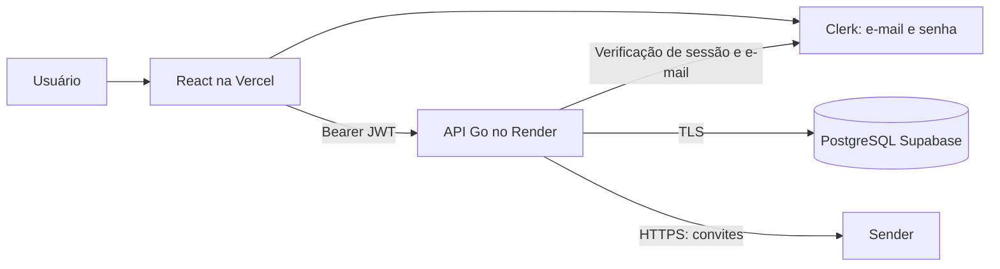

# Arquitetura e regras aceitas

O banco usa o identificador Clerk como identidade do autor. E-mails não são aceitos do frontend como prova de identidade: vêm do endereço principal verificado pelo Clerk. Administradores podem liberar acessos, sem ler catálogos particulares alheios.

Proprietário e convidados compartilham o catálogo. O limite padrão é de 50 convidados além do proprietário, contando e-mails ainda não cadastrados. Adições concorrentes bloqueiam a linha do catálogo antes da contagem. Contas universais têm uso ilimitado; não ganham acesso a catálogos sem convite. Não há cobrança nem integração de pagamentos.

Os marcadores favorito/leitura pertencem ao livro no catálogo compartilhado nesta etapa. O acompanhamento de páginas, posição PDF/EPUB, abertura de arquivos e movimentação física de arquivos continuam exclusivos do desktop. A web mostra o caminho local como texto.

Anotações são registros independentes com autor, data e conteúdo. Não atribuir anotações legadas a um usuário arbitrário: a sincronização deverá distinguir a origem desktop e preservar o conteúdo original.

Livros usam `version` para atualização e exclusão lógica. Se o cliente envia uma versão antiga, o servidor responde 409; a interface preserva o formulário. A lista usa ETag para evitar transferências repetidas quando não há mudanças. Alterações compartilhadas são consultadas periodicamente e ao retornar à janela; não há promessa de atualização remota instantânea.

## Contrato a implementar para sincronização desktop

Ainda não implementado, nem instalado. Critérios da próxima etapa:

- Login pelo navegador usando Clerk; nenhuma senha armazenada pelo desktop ou transmitida fora do Clerk.
- Botões Criar conta, Conectar conta e Sincronizar catálogo. Desktop sem conta cloud ativa continua funcionando offline e não envia dados.
- Associação explícita entre perfil SQLite, conta, catálogo cloud e instalação. Trocar a conta não pode reaproveitar associação de outra pessoa.
- Primeiro envio de todos os registros ativos, metadados, capas compatíveis, categorias, relações e anotações; não enviar arquivos digitais, binários OCR, credenciais ou posições privadas de leitura.
- Mapear IDs locais por instalação para evitar colisões; repetição de lote não duplica livros nem anotações.
- Receber cadastros/edições da nuvem e registrar digitais sem arquivo disponível sem tentar abrir ou mover caminhos remotos.
- Detectar conflito usando a versão de base conhecida. Preservar ambas as edições até resolução; não usar apenas o relógio local para escolher o vencedor.
- Exclusões precisam de tombstones e confirmação clara. Não apagar PDFs/EPUBs como consequência de sincronização.
- Upload/download em lotes, retomada após falha e transação local; preservar marcações de leitura desktop.
- Testes em cópia descartável do SQLite antes do banco pessoal.
